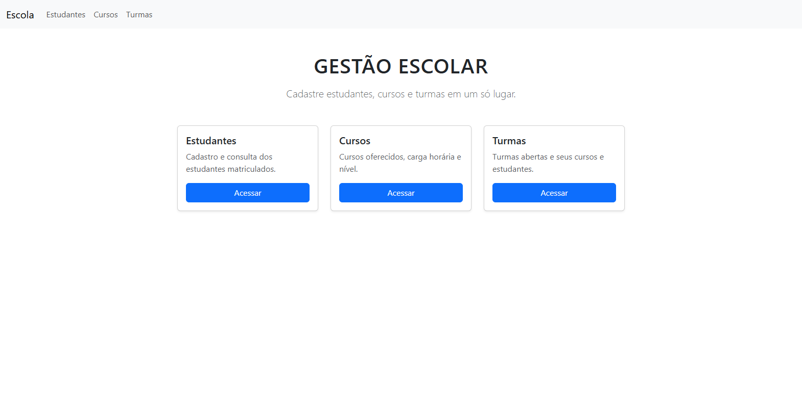
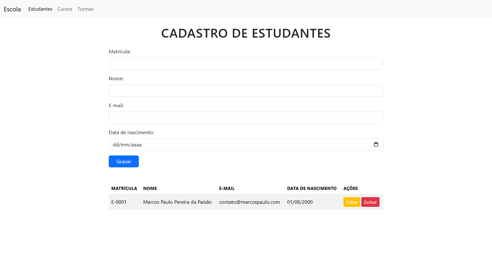
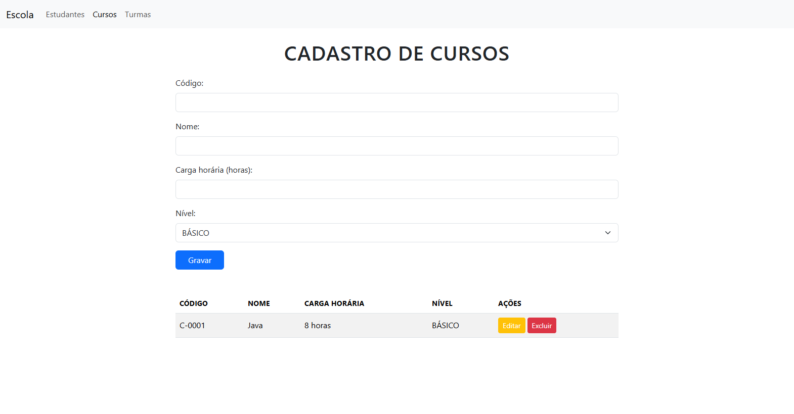
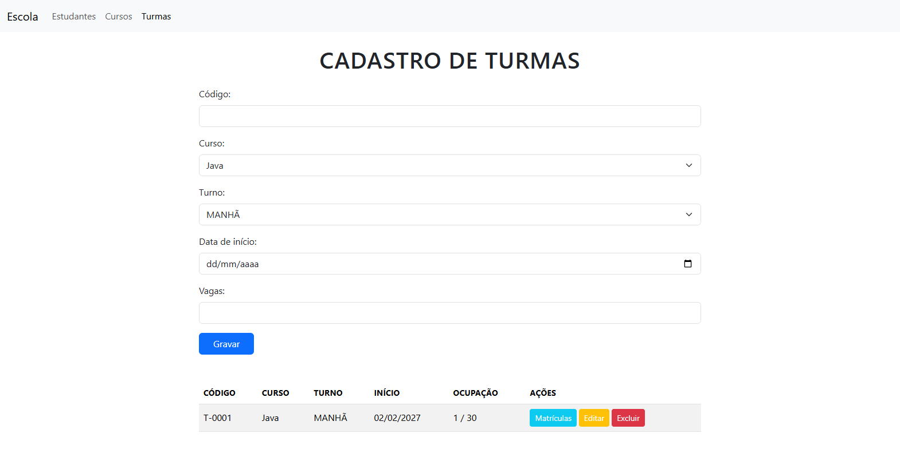
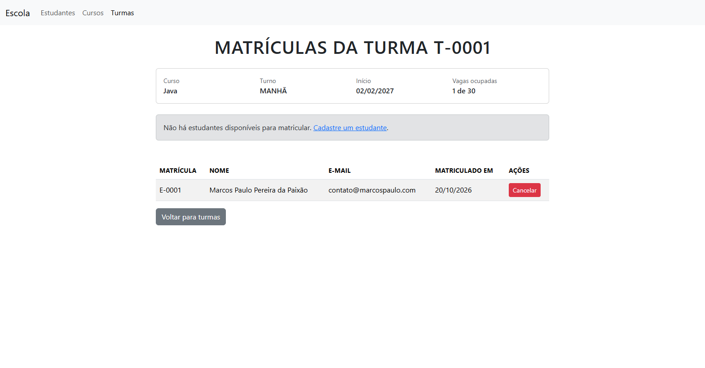

# Gestão Escolar Web

Aplicação web para cadastro de **estudantes**, **cursos**, **turmas** e **matrículas**, construída com Java puro sobre a API de Servlets (Jakarta EE), páginas JSP em sintaxe XML (JSPX), JSTL e JPA/Hibernate com banco H2.

O objetivo do projeto é mostrar uma aplicação web completa sem frameworks de alto nível: servlets, JSP, tag files e JPA, organizados de forma simples e reaproveitável.



## Funcionalidades

- **Estudantes**: cadastro com matrícula, nome, e-mail e data de nascimento.
- **Cursos**: código, nome, carga horária e nível (Básico, Intermediário, Avançado).
- **Turmas**: código, curso, turno (Manhã, Tarde, Noite), data de início e número de vagas, com indicação de vagas ocupadas.
- **Matrículas**: matrícula e cancelamento de estudantes em uma turma.
- **Regras de negócio**:
  - códigos de curso, turma e matrícula do estudante são únicos;
  - um estudante só pode ser matriculado uma vez em cada turma;
  - não é possível matricular em turma lotada;
  - as vagas de uma turma não podem ficar abaixo do número de matriculados;
  - registros em uso por outro cadastro não podem ser excluídos.
- Mensagens de sucesso e erro após cada operação, seguindo o padrão **Post/Redirect/Get**.

## Telas

| Estudantes | Cursos |
|---|---|
|  |  |

| Turmas | Matrículas |
|---|---|
|  |  |

## Tecnologias

| Camada | Tecnologia |
|---|---|
| Linguagem | Java 21 |
| Web | Jakarta Servlet 6.0, JSP (JSPX), JSTL 3.0, tag files |
| Persistência | Jakarta Persistence (JPA) com Hibernate 6.6 |
| Banco de dados | H2 (em arquivo) |
| Interface | Bootstrap 5.3 (via CDN) |
| Build | Maven (empacotamento `war`) |
| Servidor | Apache Tomcat 10.1 |

## Estrutura do projeto

```
src/main
├── java/br/dev/mpp
│   ├── modelo/          # Entidades JPA (Curso, Estudante, Turma, Matricula) e enums
│   ├── persistencia/    # Dao genérico, MatriculaDao e JPAUtil (ciclo de vida do EntityManagerFactory)
│   └── web/             # Servlets: CrudServlet genérico e um servlet por cadastro
├── resources/META-INF
│   └── persistence.xml  # Configuração do JPA/H2
└── webapp
    ├── index.jspx       # Página inicial
    └── WEB-INF
        ├── paginas/     # Telas dos cadastros (cursos, estudantes, turmas, matriculas)
        ├── tags/        # Tag files de layout, menu, cartões, ações e opções de select
        └── web.xml
```

### Arquitetura em resumo

- **`Dao<T>`** implementa o CRUD genérico (listar, buscar, salvar, excluir), abrindo um `EntityManager` por operação e controlando a transação.
- **`CrudServlet<T>`** concentra o fluxo comum dos cadastros:
  - `GET` lista os registros; com `?editar=ID` carrega o registro no formulário;
  - `POST` grava (insere ou atualiza) ou, com `acao=excluir`, remove o registro;
  - cada servlet concreto só informa como criar a entidade e preenchê-la a partir do formulário.
- **`MatriculaServlet`** trata a tela de matrículas de uma turma (`/matriculas?turma=ID`), validando vagas e duplicidade.
- **`ValidacaoException`** representa uma regra de negócio violada; a mensagem é exibida na tela.
- As páginas usam **tag files** (`layout`, `menu`, `cartao`, `acoes`, `opcao`) para evitar repetição de HTML.

## Como executar

### Pré-requisitos

- JDK 21
- Maven 3.9+
- Apache Tomcat 10.1 (ou outro container compatível com Jakarta Servlet 6.0)

### Build

```bash
mvn clean package
```

O arquivo `target/gestao-escolar-web.war` será gerado.

### Deploy

Copie o `.war` para a pasta `webapps` do Tomcat e inicie o servidor:

```bash
cp target/gestao-escolar-web.war $CATALINA_HOME/webapps/
$CATALINA_HOME/bin/startup.sh      # no Windows: startup.bat
```

Acesse: <http://localhost:8080/gestao-escolar-web/>

> Também é possível rodar direto pela IDE (por exemplo, IntelliJ IDEA com o plugin Smart Tomcat ou uma configuração de Tomcat local).

### Banco de dados

O H2 é criado automaticamente na primeira execução, em arquivo na pasta do usuário:

```
~/gestao-escolar/banco.mv.db
```

- As tabelas são criadas/atualizadas a partir das entidades (`hibernate.hbm2ddl.auto=update`).
- Usuário `sa`, sem senha.
- A URL usa `AUTO_SERVER=TRUE`, então é possível abrir o banco em um cliente SQL (ex.: IntelliJ) com a aplicação rodando:

```
jdbc:h2:~/gestao-escolar/banco;AUTO_SERVER=TRUE
```

## Rotas

| Rota | Descrição |
|---|---|
| `/` | Página inicial com atalhos para os cadastros |
| `/estudantes` | Cadastro de estudantes |
| `/cursos` | Cadastro de cursos |
| `/turmas` | Cadastro de turmas |
| `/matriculas?turma={id}` | Matrículas da turma |

## Autor

**Marcos Paulo Pereira da Paixão** — [mpp.dev.br](https://mpp.dev.br)
